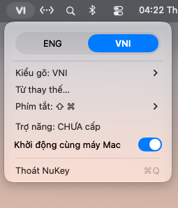

<p align="center">
  
</p>

<h1 align="center">NuKey</h1>

<p align="center">
  <a href="https://github.com/ashtonluk/nukey/releases/tag/v0.1.0"></a>
  
  
  <a href="LICENSE"></a>
</p>

<p align="center">
  Bộ gõ tiếng Việt gọn nhẹ dành cho macOS, hoạt động ngay trên thanh menu.
</p>

<p align="center">
  
</p>

## Tính năng

- Gõ tiếng Việt theo **VNI** hoặc **Simple Telex**; VNI được chọn mặc định.
- Chuyển nhanh giữa tiếng Anh và tiếng Việt bằng thanh chọn hoặc phím tắt.
- Tùy chọn tổ hợp **Control + Shift**, **Command + Shift**, **Option + Shift** hoặc tắt phím tắt.
- Tạo danh sách từ thay thế, nhập và xuất danh sách dưới dạng tệp TXT.
- Tùy chọn khởi động cùng máy Mac.
- Hoạt động trên thanh menu và không chiếm chỗ trên Dock.

## Yêu cầu

- macOS 13 trở lên.
- Máy Mac dùng Apple Silicon hoặc Intel.
- Xcode hoặc Xcode Command Line Tools có Swift 5.9 trở lên nếu biên dịch từ mã nguồn.
- Quyền **Trợ năng** và, nếu macOS yêu cầu, **Giám sát đầu vào** để xử lý phím gõ.

## Tải và cài đặt

### Cài đặt bằng Terminal

Chạy lệnh sau để tải và cài NuKey **0.1.0** vào `~/Applications`:

```bash
curl -fsSL https://raw.githubusercontent.com/ashtonluk/nukey/v0.1.0/scripts/install.sh | bash
```

Trình cài kiểm tra SHA-256 của tệp tải về trước khi cài và không ghi đè nếu `~/Applications/NuKey.app` đã tồn tại. Bạn có thể xem [mã trình cài](scripts/install.sh) trước khi chạy.

Sau khi cài, mở ứng dụng bằng lệnh sau hoặc mở **NuKey** trong thư mục **Ứng dụng** của tài khoản:

```bash
open ~/Applications/NuKey.app
```

### Tải tệp ứng dụng

Tải [NuKey 0.1.0 cho macOS](https://github.com/ashtonluk/nukey/releases/download/v0.1.0/NuKey-0.1.0-macos.zip), giải nén và chuyển `NuKey.app` vào thư mục **Ứng dụng**. Xem thêm [trang phát hành](https://github.com/ashtonluk/nukey/releases/tag/v0.1.0).

Mã kiểm tra của tệp `NuKey-0.1.0-macos.zip`:

| Thuật toán | Mã kiểm tra |
| --- | --- |
| SHA-256 | `b26e5a2d3edb63c709500fc28df32bec5e5b8ab54570055e5f1451d3f6bd4436` |
| MD5 | `f67a767e9c649f967e2c31b4d0ab7b5d` |

Để tự kiểm tra sau khi tải, mở Terminal tại thư mục chứa tệp và chạy:

```bash
shasum -a 256 NuKey-0.1.0-macos.zip
md5 NuKey-0.1.0-macos.zip
```

Bản phát hành được ký cục bộ và **chưa được Apple công chứng**, vì vậy macOS có thể chặn ứng dụng khi mở lần đầu. Nếu tin tưởng bản tải về, kiểm tra mã SHA-256 ở trên rồi cho phép mở trong **Cài đặt hệ thống → Quyền riêng tư & Bảo mật**. Bản dựng gồm cả hai kiến trúc; chưa được kiểm tra thực tế trên máy Mac Intel.

### Cài đặt từ mã nguồn

Tải mã nguồn về máy, mở Terminal tại thư mục dự án và chạy:

```bash
./scripts/build_app.sh
open build/NuKey.app
```

Ứng dụng sẽ xuất hiện trên thanh menu. Nếu muốn đặt ứng dụng trong thư mục **Ứng dụng**, hãy chuyển `NuKey.app` từ thư mục `build` trước khi mở lần đầu, rồi mở ứng dụng từ vị trí đó thay cho lệnh `open` ở trên.

Lần đầu mở, cấp quyền cho NuKey trong **Cài đặt hệ thống → Quyền riêng tư & Bảo mật → Trợ năng**. Nếu ứng dụng vẫn chưa nhận phím, kiểm tra thêm mục **Giám sát đầu vào**. Sau khi tự biên dịch lại, macOS có thể yêu cầu cấp lại quyền vì bản dựng được ký cục bộ.

## Sử dụng

### Chuyển chế độ và chọn kiểu gõ

Nhấn biểu tượng NuKey trên thanh menu để chọn **ENG** hoặc chế độ gõ tiếng Việt. Chọn **Kiểu gõ** để đổi giữa VNI và Simple Telex; lựa chọn sẽ được ghi nhớ. Khi dùng Telex, thanh chọn hiển thị **ENG / TELEX**, còn biểu tượng trên thanh menu vẫn là **EN / VI**.

Phím tắt mặc định là **Control + Shift**. Nhấn và nhả riêng tổ hợp để chuyển chế độ; bạn có thể đổi hoặc tắt phím tắt trong mục **Phím tắt**.

### Gõ tiếng Việt

| Kiểu gõ | Dấu thanh | Dấu chữ | Ví dụ |
| --- | --- | --- | --- |
| VNI | `1`, `2`, `3`, `4`, `5` | `6`, `7`, `8`, `9`; `0` bỏ dấu thanh | `co1` → `có`, `viet65` → `việt` |
| Simple Telex | `s`, `f`, `r`, `x`, `j` | `aa`, `ee`, `oo`, `aw`, `ow`, `uw`, `dd`; `z` bỏ dấu | `cos` → `có`, `tieengs` → `tiếng` |

### Từ thay thế

1. Chọn **Từ thay thế…** trong menu.
2. Nhập từ cần thay và nội dung thay bằng, rồi nhấn **Thêm**.
3. Khi đang bật gõ tiếng Việt, nhập từ gốc rồi gõ dấu cách hoặc dấu câu để thay tự động.

Bạn có thể xóa mục đã chọn hoặc dùng **Nhập TXT…** và **Xuất TXT…** để chuyển danh sách. Khi nhập, mỗi dòng là một cặp từ, ngăn bằng dấu tab, `=` hoặc `->`.

Dữ liệu được lưu tại:

```text
~/Library/Application Support/NuKey/replacements.json
```

### Khởi động cùng máy Mac

NuKey thử bật khởi động cùng máy Mac trong lần mở đầu tiên. Sau đó, bạn có thể bật hoặc tắt tùy chọn này ngay trong menu. Nếu macOS yêu cầu cho phép, hãy kiểm tra **Cài đặt hệ thống → Cài đặt chung → Mục đăng nhập**.

## Kiểm tra và đóng góp

Chạy bộ kiểm tra quy tắc gõ và phím tắt:

```bash
swift run VniCheck
```

Mọi đề xuất, báo lỗi và đóng góp đều được hoan nghênh. Khi báo lỗi, hãy mô tả các phím đã gõ, kết quả mong đợi, kết quả thực tế và phiên bản macOS.

## Giấy phép

Dự án được phát hành theo giấy phép [MIT](LICENSE). Bạn được sử dụng, sửa đổi và phân phối theo các điều kiện trong tệp giấy phép.
